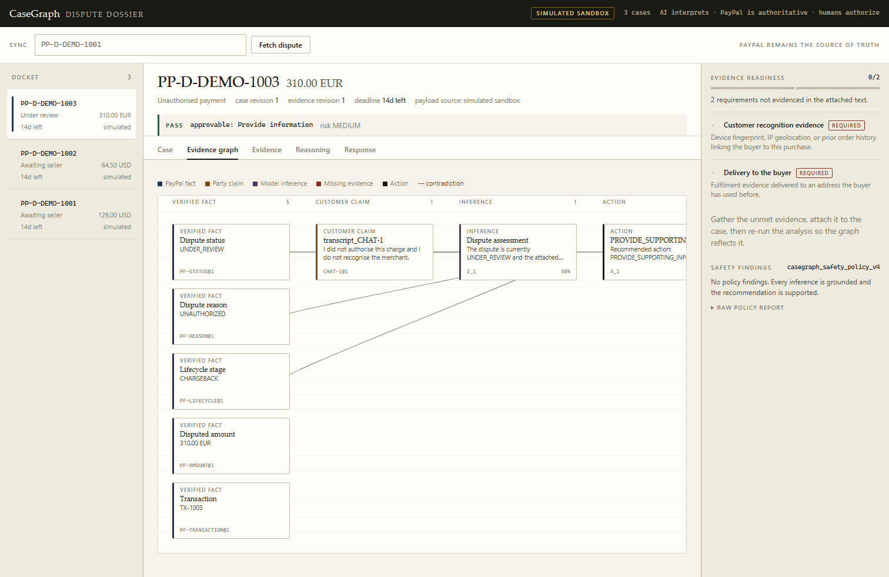

# CaseGraph

**AI-assisted PayPal dispute investigation with auditable evidence, deterministic safety, and human-approved actions.**

CaseGraph turns a messy payment dispute into a structured investigation workspace built around one operating principle:

> **AI interprets evidence. PayPal remains the financial source of truth. Humans authorize consequential actions.**

The application combines authoritative PayPal dispute state, immutable evidence, provenance-aware reasoning graphs, structured AI analysis, deterministic safety checks, durable background processing, and an explicit approval-to-execution workflow.

## Try it in two minutes (no credentials, no network)

CaseGraph ships a deterministic **simulated PayPal sandbox** so the whole
investigation can be demonstrated without a PayPal developer account or a model
key. Every simulated payload is stamped `"simulated": true`, the API refuses to
start in production with the simulated transport, and the workspace shows a
`SIMULATED SANDBOX` badge so it can never be mistaken for live money movement.

```bash
python -m venv .venv && . .venv/bin/activate        # Windows: .\.venv\Scripts\Activate.ps1
pip install -r requirements-dev.txt -r requirements-production.txt
cp .env.example .env

export CASEGRAPH_PAYPAL_TRANSPORT=simulated
python scripts/demo_seed.py --reset-simulation      # creates 3 disputes + evidence + AI analysis
uvicorn backend.main:app --reload --port 8000       # API
cd frontend && npm install && npm run dev           # workspace at http://localhost:5173
```

The seeded disputes produce three different safety outcomes:

| Dispute | Situation | What CaseGraph decides |
| --- | --- | --- |
| `PP-D-DEMO-1001` | Customer and merchant statements contradict each other | Inference is grounded, but the support node is contradicted → safety downgrades to **REVIEW** and only a low-risk clarifying message is permitted |
| `PP-D-DEMO-1002` | Damage claim with no condition evidence | Evidence gap recorded as a first-class `MISSING_EVIDENCE` node |
| `PP-D-DEMO-1003` | Unauthorised-payment claim, only clarification actions available | **PASS** for `PROVIDE_SUPPORTING_INFO`, still requiring human approval of the exact payload |

To watch the ambiguity path, restart with a fault injected into simulated writes:

```bash
export CASEGRAPH_SIMULATED_FAULT=timeout
```

Approving and executing then leaves the action in `UNKNOWN_OUTCOME`; execute again
and it is refused. Reconciliation records an `INCONCLUSIVE` probe and keeps the
block, until an operator confirms the real outcome in the PayPal dashboard:

```bash
python scripts/reconcile_action.py <case-id> <action-uid> CONFIRMED_NOT_EXECUTED \
  --confirmed-by analyst@example.com --note "No message in the PayPal thread" \
  --confirm-paypal-dashboard
```

Reasoning provider selection is explicit and recorded per analysis
(`model_provider` / `model_name`): `CASEGRAPH_AI_PROVIDER=auto` prefers OpenAI
(via `/v1/responses` or `/v1/chat/completions` for OpenAI-compatible providers
such as DeepSeek) when a key is present and otherwise uses the deterministic
reference reasoner outside production.

## Interface



CaseGraph is presented as a **dispute dossier**: a case docket on the left, the
investigation canvas in the centre, and an inspector that shows either the
provenance of the selected node or the case's evidence readiness. The verdict bar
is always visible, so the decision state is never hidden behind navigation.

The design direction, references and rationale are in
[`research/aris-casegraph-audit/12-design-direction.md`](research/aris-casegraph-audit/12-design-direction.md);
the control-flow diagram is
[`figures/architecture.svg`](research/aris-casegraph-audit/figures/architecture.svg).

## Why CaseGraph

Payment disputes combine transaction state, customer claims, support notes, tracking information, evidence attachments, changing dispute lifecycle state, and actions that may move money. CaseGraph keeps those sources separate and auditable instead of collapsing them into a single AI-generated answer.

The system is designed so that PayPal API responses remain authoritative for financial state; human statements remain claims unless independently supported; external evidence remains source-backed evidence; AI output is structured and provenance-checked; consequential actions require approval of the exact payload; and ambiguous remote write outcomes fail closed instead of being blindly retried.

## Architecture

```text
PayPal API / Webhooks        Support Evidence        Uploaded Files
        │                          │                       │
        └──────────────┬───────────┴───────────────┬──────┘
                       ▼                           ▼
             Immutable Case State        Immutable Evidence Store
                       │                           │
                       └────────────┬──────────────┘
                                    ▼
                           Frozen AI Input Bundle
                                    │
                                    ▼
                         Structured AI Reasoning
                                    │
                                    ▼
                           CaseGraph + Provenance
                                    │
                                    ▼
                      Deterministic Safety Policy
                                    │
                                    ▼
                         Human Approval of Exact
                              Typed Action Payload
                                    │
                                    ▼
                         Fresh PayPal Revalidation
                                    │
                                    ▼
                           PayPal Action Execution
                                    │
                                    ▼
                    Durable Sync / Reconciliation
```

See [`docs/ARCHITECTURE.md`](docs/ARCHITECTURE.md) for the complete design.

## Repository layout

```text
backend/                 FastAPI application and domain services
  actions/               Typed action schemas and validation
  ai/                    Frozen-bundle AI reasoning pipeline
    providers/           OpenAI (Responses API + Chat Completions) and the deterministic reference reasoner
  api/                   HTTP API routes
  casegraph/             Graph domain and validation
  db/                    SQLAlchemy models and session management
  paypal/                PayPal OAuth, disputes, transport, webhooks, simulated sandbox
  safety/                Deterministic safety policy
  security/              OIDC/JWT, RBAC, rate limiting, observability
  uploads/               Secure evidence-file handling
  work/                  Durable queue, leases, reconciliation

frontend/                React investigation workspace
  src/components/        Graph canvas, provenance/readiness inspector, typed action composer
  src/lib/               Deterministic graph layout and formatting

evaluation/benchmark/    Reproducible model/safety benchmark
validation/              Controlled user-validation framework
submission/              Public-release and submission tooling
migrations/              Alembic migrations
deploy/                  Docker and production deployment examples
scripts/                 Operational, verification, benchmark, and release CLIs
  demo_seed.py           Seeds the simulated-sandbox demonstration
tests/                   Backend, security, integration, validation, and release tests
docs/                    Architecture and operational documentation
research/                Research and audit artifacts for the current submission cycle
```

## Prerequisites

Local development requires Python 3.12+, Node.js 22+, and npm 10+. Production-like validation additionally uses PostgreSQL, Redis, OIDC/JWKS, ClamAV, an OpenTelemetry collector, PayPal sandbox credentials, and OpenAI or DeepSeek API credentials.

## Quick start

### 1. Create the Python environment

```bash
python -m venv .venv
```

Windows PowerShell:

```powershell
.\.venv\Scripts\Activate.ps1
```

Linux/macOS:

```bash
source .venv/bin/activate
```

Install dependencies:

```bash
python -m pip install --upgrade pip
pip install -r requirements-dev.txt -r requirements-production.txt
```

### 2. Configure local environment

```bash
cp .env.example .env
```

PowerShell:

```powershell
Copy-Item .env.example .env
```

Local development defaults to SQLite, simulated PayPal transport, and disabled authentication. Do not use those defaults for production.

`.env` is loaded automatically at startup by `backend/config.py` (via `python-dotenv`,
with `override=False`), so a real shell or CI environment still wins. No `--env-file`
flag is required.

> Remaining external owner steps (such as recording the demo video and publishing the repo URL) are tracked in [`docs/REMAINING_WORK.md`](docs/REMAINING_WORK.md).

### 3. Run migrations

```bash
alembic upgrade head
```

### 4. Run diagnostics

```bash
python scripts/doctor.py
```

### 5. Start the API

```bash
uvicorn backend.main:app --reload --port 8000
```

Development endpoints:

```text
http://127.0.0.1:8000/health
http://127.0.0.1:8000/ready
http://127.0.0.1:8000/docs
```

API documentation is intentionally disabled in production mode.

### 6. Start the worker

In a second terminal:

```bash
python scripts/worker.py
```

For a one-shot worker check:

```bash
python scripts/worker.py --once
```

### 7. Start the frontend

```bash
cd frontend
npm install
npm run typecheck
npm run build
npm run dev
```

Vite normally serves the application at `http://localhost:5173`.

## Verification

Run the deterministic repository verification suite:

Linux/macOS:

```bash
./scripts/verify.sh
```

Windows PowerShell:

```powershell
.\scripts\verify.ps1
```

`pytest` is safe to run at any time: `tests/conftest.py` binds the suite to an
isolated per-process SQLite file and cleans it up on exit, so a test run can
never drop tables in your development database or leave temporary files behind.

Useful individual diagnostics:

```bash
python scripts/doctor.py
python scripts/security_doctor.py
python scripts/integration_doctor.py
python scripts/operations_doctor.py
python scripts/benchmark_doctor.py --require-casegraph
python scripts/validation_doctor.py
python scripts/release_scan.py
```

See [`docs/TESTING.md`](docs/TESTING.md) for the test strategy and external gates. The latest local verification record is in [`docs/VERIFICATION.md`](docs/VERIFICATION.md).

## Security model

Production mode is fail-closed. It requires PostgreSQL, authenticated users, explicit origins, verified PayPal webhooks, Redis-backed rate limiting, secure evidence scanning, and an up-to-date database schema.

The backend supports OIDC/JWT authentication, role-based authorization, deployment-tenant binding, resource limits, upload validation, file hashing, malware scanning, and OpenTelemetry instrumentation.

Roles:

```text
VIEWER      Read investigations
ANALYST     Add evidence and run analysis
APPROVER    Approve and execute permitted actions
ADMIN       Administrative operations
```

For sensitive actions, analyst/approver role separation can require a different authenticated principal to approve the action.

See [`docs/SECURITY.md`](docs/SECURITY.md).

## PayPal write safety

CaseGraph treats dispute writes as potentially non-idempotent unless the provider explicitly documents otherwise.

```text
confirmed 2xx          -> EXECUTED
explicit client error  -> FAILED
timeout/network/5xx    -> UNKNOWN_OUTCOME
```

`UNKNOWN_OUTCOME` is never blindly retried. The action remains blocked until reconciliation determines the remote state.

## Evidence files

Evidence uploads are private and immutable. Files are validated by extension, detected content type, size, malware-scanning policy, and SHA-256. Approved file actions bind both the file identifier and expected hash, and execution re-hashes stored bytes before sending them to PayPal.

## Evaluation benchmark

The benchmark compares the full CaseGraph reasoning/safety pipeline with a raw-model baseline using development, held-out, and red-team scenarios.

```bash
python scripts/benchmark.py describe
python scripts/benchmark.py run --mode casegraph_live --split dev --output evaluation_runs/casegraph.jsonl
python scripts/benchmark.py run --mode raw_llm --split dev --output evaluation_runs/raw.jsonl
python scripts/benchmark.py score \
  --predictions evaluation_runs/casegraph.jsonl evaluation_runs/raw.jsonl \
  --report evaluation_runs/report.json
```

Holdout execution is locked by default to reduce evaluation leakage.

## Product validation

The repository contains a counterbalanced controlled-study framework for comparing normal dispute investigation with the CaseGraph interface. Pilot mode is explicitly separated from live-product validation and the protocol is hash-locked before confirmatory data collection.

See [`docs/VALIDATION_PROTOCOL.md`](docs/VALIDATION_PROTOCOL.md).

## Production deployment

Use `.env.production.example` as the production configuration reference and `deploy/compose.production.yml` as an example deployment topology.

Before deployment, complete [`docs/RELEASE_CHECKLIST.md`](docs/RELEASE_CHECKLIST.md). Local tests alone are not evidence that external services have been validated.

## Database migrations

Fresh installations use the migration chain in `migrations/versions/`. If you are upgrading a historical CaseGraph database from an earlier development branch, read [`docs/MIGRATIONS.md`](docs/MIGRATIONS.md) before applying migrations.

## Public release

Before publishing the repository:

```bash
python scripts/release_scan.py
python scripts/build_public_release.py --repo . --output casegraph_public_release.zip
python scripts/verify_public_release.py casegraph_public_release.zip
```

Do not publish `.env`, uploaded evidence, participant data, private evaluation outputs, private keys, or credentials.

## Project status

This repository is a **production-hardened release candidate**. Deterministic local verification is included, but production claims require successful validation of PostgreSQL concurrency, Redis, OIDC/JWKS, ClamAV, OpenTelemetry, frontend dependency installation/build, OpenAI, and PayPal sandbox workflows.

## License

Released under the [MIT License](LICENSE).
